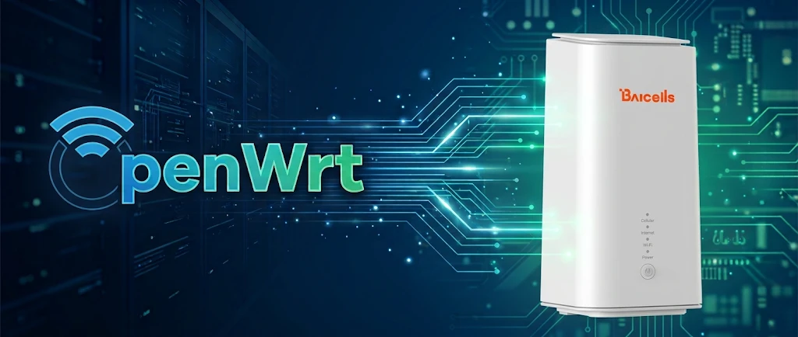

# OpenWrt for Baicells EG3065M-NR9

OpenWrt port for the Baicells EG3065M-NR9 5G CPE (MediaTek MT7981, built-in Quectel
RG500U-EB 5G modem). The stock firmware is the Safaricom (Kenya) build.

Working: 5G data through QModem, Wi-Fi 2.4 + 5 GHz, 3x LAN, LEDs, buttons, correct MAC
addresses, sysupgrade. The stock firmware stays in the second slot and can be restored.

Prebuilt images are on the [Releases](../../releases/latest) page.

> **Unofficial.** This board is not in upstream OpenWrt. Take a full flash backup before
> installing (see below). You do this at your own risk.

## Hardware

| Component | Details |
|---|---|
| SoC | MediaTek MT7981B (Filogic 820), dual Cortex-A53 |
| RAM | 256 MiB DDR3 |
| Flash | 128 MiB SPI-NAND, NMBM, A/B layout (`ubi` / `ubi1`) |
| Modem | Quectel RG500U-EB (Unisoc), soldered, USB 3.0, CDC-NCM, USB ID `2c7c:0900` |
| Wi-Fi | MT7981 2.4 GHz + 5 GHz (802.11ax), `mt7915e` driver |
| Switch | MT7531, 3 LAN ports on the case (labelled LAN, LAN, LAN/WAN) |
| LEDs | `green:lte`, `green:internet`, `yellow:lte`, `green:wlan2g`, `green:wlan5g` |
| Buttons | reset, WPS |
| Serial | `ttyS0`, 115200 8N1 |
| Stock firmware | OpenWrt 21.02-based, Linux 5.4 |

MAC addresses are read from the `product` partition (LAN `0xb4`, WAN `0xa8`, Wi-Fi `0xae`
and `0x1d6`). Wi-Fi calibration is in `Factory`.

### Modem ports

| Port | Use |
|---|---|
| `ttyUSB2` | AT commands |
| `ttyUSB0` | DM / diagnostics |
| `usb0` ... `usb3` | four NCM data interfaces, one per PDN. PDN 1 is `usb0` |

## Default configuration of the release image

| Setting | Value |
|---|---|
| LAN | all 3 ports, `192.168.1.1`, DHCP server |
| WAN | 5G through QModem, interfaces `2_1` / `2_1v6` on `usb0`. APN empty (operator default). There is no Ethernet WAN |
| Login | `root`, **no password** |
| Wi-Fi | **enabled and open (no password)**: `EG3065M-NR9` (2.4 GHz) and `EG3065M-NR9_5G` (5 GHz), country `TR` |
| Web UI | LuCI, Turkish language, timezone Europe/Istanbul |
| TTL | packets leaving `usb0` get TTL / hop limit 65 (`/etc/nftables.d/10-wwan-ttl.nft`) |
| Hostname | `EG3065M-NR9` |

> **Right after the first boot:** set a root password and a Wi-Fi password. Until you do,
> anyone in range can join the open Wi-Fi, use your 5G connection and log in as root.

The language, timezone and TTL rule come from
[`files/etc/uci-defaults/99-eg3065m-custom`](files/etc/uci-defaults/99-eg3065m-custom) and
[`files/etc/nftables.d/10-wwan-ttl.nft`](files/etc/nftables.d/10-wwan-ttl.nft). Change them
in LuCI, or drop them when building your own image.

## Serial console (UART)

- 115200 8N1, 3.3 V TTL. Connect GND, TX and RX only. Do not connect VCC.
- The stock firmware gives a passwordless root shell on the console.
- U-Boot shows a boot menu. Press **Ctrl+C** to get a prompt. Enter selects
  "Startup system" and boots the stock firmware.

## Installation (UART + TFTP, tested)

You need a USB-TTL serial adapter, an Ethernet cable and a TFTP server on your PC.

### 1. Boot the recovery image from RAM

Put `openwrt-mediatek-filogic-baicells_eg3065m-nr9-initramfs-recovery.itb` in the TFTP
server root, give the PC the address `192.168.1.2/24` and connect it to a LAN port.

Power on, press Ctrl+C in the U-Boot menu, then:

```
setenv serverip 192.168.1.2
tftpboot 0x46000000 openwrt-mediatek-filogic-baicells_eg3065m-nr9-initramfs-recovery.itb
bootm 0x46000000
```

Nothing is written to flash. A power cycle brings the stock firmware back.

### 2. Back up the flash

OpenWrt is now running from RAM at `192.168.1.1`. Copy every partition to your PC.
`Factory` (Wi-Fi calibration), `product` (MAC addresses) and `user-data` (boot slot
header) are unique to your unit. Keep `user-data` in particular: you need it to go back to
stock.

```sh
# on the PC
for i in $(seq 0 9); do
  ssh root@192.168.1.1 "cat /dev/mtd$i" > mtd$i.bin
done
ssh root@192.168.1.1 cat /proc/mtd > proc_mtd.txt
```

### 3. Install to flash

```sh
scp -O openwrt-mediatek-filogic-baicells_eg3065m-nr9-squashfs-sysupgrade.bin root@192.168.1.1:/tmp/
ssh root@192.168.1.1 sysupgrade -n /tmp/openwrt-mediatek-filogic-baicells_eg3065m-nr9-squashfs-sysupgrade.bin
```

OpenWrt is written to slot A (`ubi`). The stock firmware in slot B (`ubi1`) is not touched.

#### How booting works

The stock U-Boot (`mtkboardboot`) does not use the U-Boot environment to pick a slot. It
reads a header in the `user-data` partition (magic `0x12345678`) that names the boot slot
and stores the size and CRC32 of the `kernel` and `rootfs` volumes. The sysupgrade handler
in this port points that header at slot A, writes the new sizes and sets both CRCs to
`0xffffffff`, which makes U-Boot skip the check. Later sysupgrades from LuCI work the same
way.

### Going back to stock

Write your original `user-data` back. This points U-Boot at slot B again:

```sh
scp -O mtd3.bin root@192.168.1.1:/tmp/
ssh root@192.168.1.1 "mtd write /tmp/mtd3.bin user-data && reboot"
```

## Alternative: installing from the stock firmware (untested)

The stock firmware has a hidden web console with a root shell at
`http://192.168.150.1/cgi-bin/luci/admin/mtk/console`, and SSH on port `27149` (key login
only; add your key to `/etc/dropbear/authorized_keys` from the web console). In principle
the same steps the sysupgrade handler does can be run from there:

1. Extract `kernel` and `root` from the sysupgrade tar.
2. `ubiformat` slot A (`ubi`, mtd7), attach it, create the `kernel`, `rootfs` and
   `rootfs_data` volumes and write the two images with `ubiupdatevol`.
3. Update the `user-data` header: boot slot `ubi`, the two sizes, CRCs `0xffffffff`
   (see `baicells_set_bootpart` in [`openwrt/mediatek-filogic.diff`](openwrt/mediatek-filogic.diff)).

**This path has not been tested with the release image.** An earlier attempt with a generic
image left the device stuck in U-Boot and had to be recovered over UART. Only try it if you
can connect a serial console.

## Building from source

The release was built from OpenWrt `main` (snapshot) at `r36644-72bb125aec`, kernel 6.18.52.

1. Copy [`target/linux/mediatek/dts/mt7981b-baicells-eg3065m-nr9.dts`](target/linux/mediatek/dts/mt7981b-baicells-eg3065m-nr9.dts)
   into the same path in the OpenWrt tree.
2. Apply [`openwrt/mediatek-filogic.diff`](openwrt/mediatek-filogic.diff): image recipe
   (`filogic.mk`), network and LED setup, and the sysupgrade handler.
3. Optional: copy [`files/`](files) to the tree root for the defaults listed above.
4. Add [QModem](https://github.com/FUjr/QModem) to `feeds.conf` and select
   `luci-app-qmodem-next`. QModem does not know the RG500U-EB yet; add these two entries
   (the release image has them):

   `/usr/share/qmodem/modem_support.json`, under `modem_support.usb`:

   ```json
   "rg500u-eb": {
       "manufacturer_id": "2c7c",
       "manufacturer": "quectel",
       "platform": "unisoc",
       "data_interface": "usb",
       "pdp_index": "1",
       "wcdma_band": "1/2/5/8",
       "lte_band": "1/2/3/4/5/7/8/20/28/38/40/41/66",
       "nsa_band": "1/3/5/7/8/20/28/38/40/41/66/77/78",
       "sa_band": "1/3/5/7/8/20/28/38/40/41/66/77/78",
       "modes": ["ecm", "mbim", "rndis", "ncm"]
   }
   ```

   `/usr/share/qmodem/modem_port_rule.json`, under `usb`:

   ```json
   "2c7c:0900": {
       "name": "rg500u-eb",
       "mode": "ncm",
       "option_driver": 1,
       "include": ["1.4"]
   }
   ```

5. `make menuconfig`: Target `MediaTek ARM`, subtarget `Filogic 8x0 (MT798x)`, profile
   `Baicells EG3065M-NR9`. Then `make -j$(nproc)`.

## Repository layout

| Path | Contents |
|---|---|
| `target/linux/mediatek/dts/mt7981b-baicells-eg3065m-nr9.dts` | device tree |
| `openwrt/mediatek-filogic.diff` | changes to the OpenWrt tree |
| `files/` | first-boot defaults and the TTL rule used in the release image |

## License

[GPL-2.0](LICENSE), the same as OpenWrt and the Linux kernel. The device tree is
dual-licensed `GPL-2.0 OR MIT`, as stated in its header.
